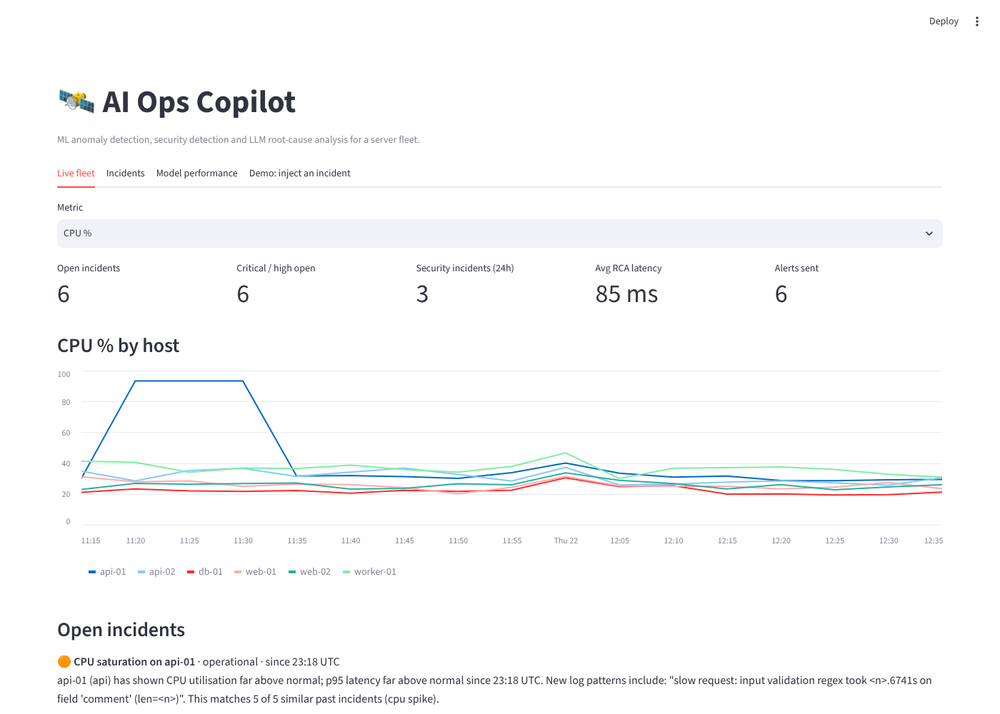
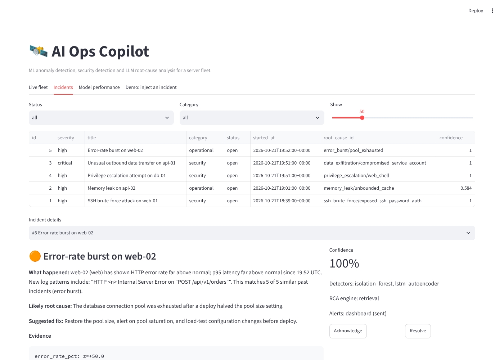
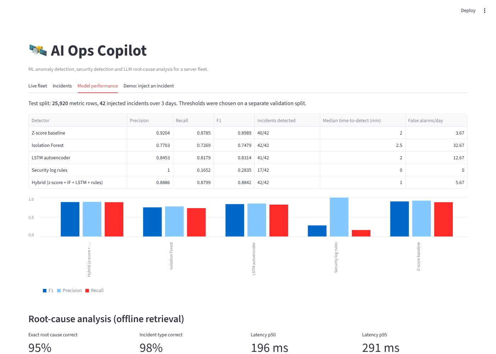
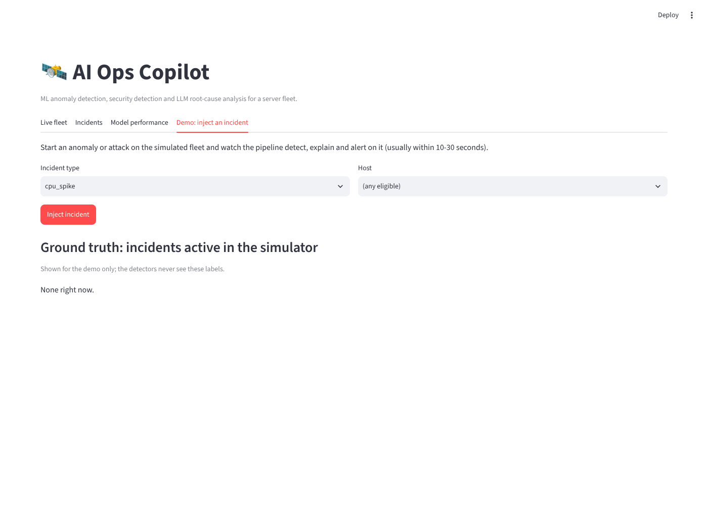
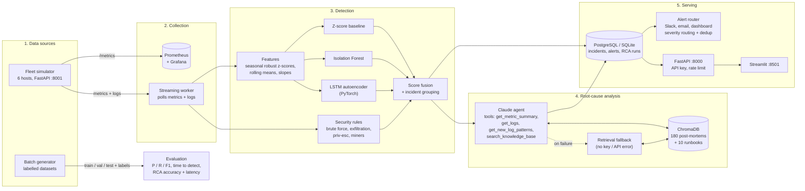

# AI Ops Copilot

**An AI-powered monitoring assistant for a server fleet.** It collects metrics and logs, detects
operational and security anomalies with machine learning (z-score baseline, Isolation Forest, LSTM
autoencoder, security rules), explains the likely root cause in plain English with an LLM agent grounded
in past incident reports (RAG), and sends alerts to Slack, email and a web dashboard.

 
 
 

## Results

Measured on a held-out 3-day test split (25,920 metric rows, 42 injected incidents, 6 hosts) that the
models never saw. Thresholds were chosen on a separate validation split. Full report:
[reports/detection_results.md](reports/detection_results.md).

| Detector | Precision | Recall | F1 | Incidents detected | Median time to detect | False alarms / day |
|---|---|---|---|---|---|---|
| Z-score baseline | 0.920 | 0.878 | **0.899** | 40/42 (95%) | 2.0 min | **3.7** |
| Isolation Forest | 0.770 | 0.727 | 0.748 | 42/42 (100%) | 2.5 min | 32.7 |
| LSTM autoencoder | 0.845 | 0.818 | 0.831 | 41/42 (98%) | 2.0 min | 12.7 |
| Security log rules | 1.000 | 0.165 | 0.283 | 17/42 (40%) | 0.0 min | 0.0 |
| **Hybrid (z-score + IF + LSTM + rules)** | 0.889 | **0.880** | 0.884 | **42/42 (100%)** | **1.0 min** | 5.7 |

Root-cause analysis on the detected test incidents ([reports/rca_results.md](reports/rca_results.md)):

| RCA engine | Exact root cause correct | Incident type correct | Latency p50 | Latency p95 |
|---|---|---|---|---|
| Retrieval (offline, no API key) | 97.7% (42/43) | 97.7% | 0.21 s | 0.27 s |
| Claude agent with tools | run `python -m aiops_copilot.evaluation.run_rca --engine llm --limit 20` with your key | | | |

Other numbers: training takes about 20 s on a laptop CPU, scoring costs 0.1 ms per metric row, and
the detector's guess of the incident type (before RCA) is right 93% of the time.

**What the table says.** The hybrid is the only detector that catches every incident, and it is the
fastest. It trades a little precision for that. The simple z-score baseline is strong because the
seasonal scaling (per host, per hour of day) already removes most normal variation. The LSTM adds
recall on slow, sequence-shaped problems (memory leaks, privilege escalation). Isolation Forest alone
is noisy. The security rules never raise false alarms but only see attacks that leave log signatures,
which is why they are fused with the metric models rather than used alone.

## Screenshots

| Live fleet | Incident with root cause and fix |
|---|---|
|  |  |
| **Model performance** | **Demo: inject an attack** |
|  |  |

## Architecture



A rendered copy is in [docs/architecture.png](docs/architecture.png). Design decisions are in
[docs/ARCHITECTURE.md](docs/ARCHITECTURE.md).

**How one incident flows through the system:**

1. The **worker** pulls the newest metrics and logs every few seconds and keeps a 4-hour buffer per host.
2. Every metric is turned into a **robust z-score** against that host's normal level for that hour of day.
3. Four detectors score each row. Their scores are normalised by their own thresholds and **fused**; any
   security-rule hit also raises an alarm.
4. Alarms on the same host close in time are **grouped** into one incident with a suspected type.
5. The **RCA engine** investigates: the Claude agent calls tools to read metrics, logs and new log
   patterns, searches the knowledge base of past post-mortems, and returns a JSON answer validated
   against a schema. Without a key, or if the API fails, a retrieval engine answers instead.
6. The incident, root cause and fix are stored, **alerts** go out by severity, and the **dashboard**
   shows everything.

## Quick start (Windows, VS Code)

You need **Python 3.11+** ([python.org](https://www.python.org/downloads/), tick "Add to PATH").
Docker Desktop is optional.

```powershell
# 1. In VS Code: File > Open Folder > ai-ops-copilot, then open a terminal (Ctrl+`)
# 2. One-time setup: installs everything, runs the tests, trains the models, builds the knowledge base
powershell -ExecutionPolicy Bypass -File scripts/setup.ps1

# 3. Start the live system (opens 4 windows: simulator, API, worker, dashboard)
powershell -ExecutionPolicy Bypass -File scripts/run_local.ps1
```

Then open **http://localhost:8501**, go to the **Demo** tab and inject an `ssh_brute_force` attack.
Within about 30 seconds it shows up in **Incidents** with a root cause and a fix.

**macOS / Linux:** `bash scripts/setup.sh`, then `bash scripts/run_local.sh`.

**Docker (everything, including PostgreSQL, Prometheus and Grafana):**

```bash
cp .env.example .env          # Windows: copy .env.example .env  (then set the two passwords)
docker compose up -d --build  # first start trains the models inside the worker (~2-3 min)
```

| Service | URL |
|---|---|
| Dashboard | http://localhost:8501 |
| API docs (Swagger) | http://localhost:8000/docs |
| Simulator API docs | http://localhost:8001/docs |
| Grafana (admin / your password) | http://localhost:3000 |
| Prometheus | http://localhost:9090 |

### Turn on the LLM (optional)

Put your Anthropic API key in `.env`:

```ini
LLM_API_KEY=sk-ant-...
LLM_MODEL=claude-opus-5-5
```

Restart the worker. New incidents are then explained by the Claude agent (engine shown as
`llm:claude-opus-5-5` in the dashboard). With no key, the system works fully offline with the retrieval
engine. If the API errors, times out, refuses, or returns invalid JSON, that incident automatically falls
back to retrieval, so alerts are never blocked.

### Alerts (optional)

Set `SLACK_WEBHOOK_URL` (an `https://hooks.slack.com/...` incoming webhook) and/or the `SMTP_*` and
`ALERT_EMAIL_TO` settings in `.env`. Routing: critical and high go to Slack, email and dashboard; medium
to Slack and dashboard; low to the dashboard only. The same alert is not re-sent within
`ALERT_COOLDOWN_MINUTES`.

## Commands

| What | Command |
|---|---|
| Run the tests (86 tests, about 1 min) | `python -m pytest` |
| Lint and strict type check | `ruff check src tests dashboard` and `mypy` |
| Train + evaluate detectors, write `reports/` | `python -m aiops_copilot.evaluation.run_detection` |
| Build the RAG knowledge base | `python -m aiops_copilot.rag.build` |
| Evaluate RCA (offline) | `python -m aiops_copilot.evaluation.run_rca` |
| Evaluate RCA with Claude (costs API credits) | `python -m aiops_copilot.evaluation.run_rca --engine llm --limit 20` |
| Simulator / API / worker / dashboard | `python -m aiops_copilot.simulator`, `python -m aiops_copilot.api`, `python -m aiops_copilot.pipeline.worker`, `streamlit run dashboard/app.py` |
| Generate a labelled dataset | `python -m aiops_copilot.generator generate --hours 24` |

VS Code's **Run and Debug** panel has the same commands, plus a compound **"Live system"** that starts
all four services with one click. What to test and the expected output for each step:
[docs/TESTING.md](docs/TESTING.md).

## How it works and why

### Synthetic data (no real servers needed)

A step-based simulator produces a 6-host fleet (2 web, 2 api, 1 db, 1 worker) with 10 metrics per
minute and realistic logs:

* **Normal behaviour:** daily and weekly seasonality, autocorrelated AR(1) noise, slow disk growth, random blips.
* **Hard negatives** that look unusual but are normal: the nightly DB backup, deploys, log rotation, a
  single mistyped SSH password, legitimate `sudo` use.
* **10 incident types:** CPU spike, memory leak, disk fill, latency degradation, error burst, traffic
  surge, SSH brute force, data exfiltration, privilege escalation, suspicious process (crypto-miner /
  reverse shell). Each has 1-3 concrete **root causes** (17 in total), each leaving its own clue log line.
* **Labels** on every metric row, every log line, and every incident (with root cause and fix).

### ML choices

| Choice | Why |
|---|---|
| **Seasonal robust scaling** (median and IQR per host and hour of day) | A web server at 70% CPU at noon is normal; at 3 a.m. it is not. Median/IQR are not pulled by the anomalies themselves. |
| **Z-score baseline** | Always start with the simplest model. It is the bar the ML models must beat, and it is explainable. |
| **Isolation Forest** | Unsupervised, fast, no labels needed, handles many features. Trained on absolute deviations so "too low" and "too high" are treated alike. |
| **LSTM autoencoder** | Learns what normal 20-minute sequences look like and flags shapes it cannot reconstruct, such as slow ramps that are anomalous as a trend but not at any single point. |
| **Security rules** | Attacks like brute force have exact signatures in logs. Rules give zero false alarms and explainable evidence; ML gives coverage for what rules miss. |
| **Thresholds from a validation split** (best F1) | Never tune on the test set. Each split uses a different random seed. |
| **Fusion** (mean or max of threshold-normalised scores, chosen on validation) OR rule hits | Each model covers others' blind spots; normalising by thresholds puts scores on one scale. |
| **Detection before LLM** | The LLM explains incidents, it does not detect them. That keeps cost and latency low and the system testable. |

### RAG and the LLM agent

* **Knowledge base:** 180 post-mortems from 30 days of simulated history plus 10 runbooks, stored in
  ChromaDB. Each post-mortem has symptoms, log templates (numbers and IPs masked), root cause and fix.
  Embeddings are LSA (TF-IDF + SVD), which run offline; `EMBEDDING_BACKEND=sentence-transformers` is
  supported too.
* **Agent:** a manual tool-use loop with Claude. Tools return only what the model asks for, logs are
  treated as untrusted data in the system prompt, and the final answer is forced into a JSON schema
  (structured outputs) and validated again with Pydantic.
* **Graceful degradation:** no key, API error, refusal, truncation, invalid JSON, or too many tool
  rounds all fall back to the retrieval engine for that incident.

## Security

* No secrets in code. Everything comes from `.env` (git-ignored); `.env.example` documents every setting.
* API: `X-API-Key` checked in constant time, per-client rate limiting, bounded and validated inputs
  (Pydantic), CORS restricted to the dashboard.
* Slack alerts only go to `https://hooks.slack.com/` URLs; SMTP uses STARTTLS.
* Containers run as a non-root user; ports are bound to `127.0.0.1`.
* Ground-truth labels are stripped before data reaches the detectors or the LLM.

## Project structure

```
ai-ops-copilot/
├── src/aiops_copilot/
│   ├── core/          settings (.env), logging
│   ├── generator/     synthetic fleet, incidents, root causes, logs
│   ├── simulator/     live fleet API (+ Prometheus /metrics, incident injection)
│   ├── features/      seasonal robust scaling, feature engineering
│   ├── detection/     z-score, Isolation Forest, LSTM autoencoder, security rules, fusion, grouping
│   ├── evaluation/    metrics, detection and RCA evaluation scripts
│   ├── rag/           embeddings, ChromaDB store, knowledge base builder
│   ├── llm/           evidence tools, Claude RCA agent, retrieval RCA
│   ├── db/            SQLAlchemy models + repository
│   ├── alerts/        Slack, email, dashboard routing with dedup
│   ├── api/           FastAPI app, auth, rate limiting
│   └── pipeline/      real-time worker
├── dashboard/app.py   Streamlit UI
├── knowledge_base/runbooks/   10 runbooks indexed for RAG
├── reports/           evaluation results (regenerated by the scripts)
├── tests/             86 tests: unit, API, LLM agent with a fake client, end-to-end worker
├── docs/              architecture, testing guide, project report, demo script, resume bullets, interview Q&A
├── infra/             Prometheus + Grafana provisioning
├── scripts/           setup and run scripts (Windows + macOS/Linux)
├── Dockerfile, docker-compose.yml, .github/workflows/ci.yml
└── .env.example
```

## Limitations and next steps

* The data is simulated. Real fleets have messier logs and concept drift, so the next step is a
  Prometheus + Loki adapter and periodic retraining.
* The retrieval engine's confidence is the vote share among similar incidents, not a calibrated
  probability. Its one test miss had confidence 1.0 (a benign SSH login line pulled an early memory-leak
  alarm toward "brute force").
* Known maintenance (the 02:00 backup) can still trigger an alarm; a maintenance-window calendar would
  remove it.
* Rate limiting is in-process; several API replicas would need Redis.

## Documents

* [docs/PROJECT_REPORT.md](docs/PROJECT_REPORT.md): full project report (problem, method, results, discussion)
* [docs/DEMO_SCRIPT.md](docs/DEMO_SCRIPT.md): 3-minute demo script
* [docs/RESUME_BULLETS.md](docs/RESUME_BULLETS.md): resume bullets with measured results
* [docs/INTERVIEW_QA.md](docs/INTERVIEW_QA.md): 10 interview questions with answers
* [docs/TESTING.md](docs/TESTING.md): what to test and the expected output

## License

MIT
