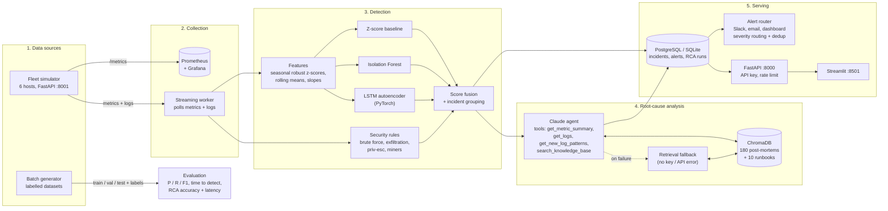

# Architecture

AI Ops Copilot watches a fleet of servers, detects operational and security anomalies with ML,
explains the likely root cause in plain English using an LLM grounded in past incident reports
(RAG), and alerts on-call engineers.

## System diagram

A rendered copy is in [architecture.png](architecture.png) if your Markdown viewer does not support Mermaid.

## Request flow (one incident, end to end)

1. The simulator (or a real host) exposes metrics; Prometheus scrapes them for Grafana. The **worker** polls the newest metrics and logs and keeps a 4-hour buffer per host.
2. The feature pipeline turns every metric into a robust z-score against that host's median for the same hour of day, then adds rolling means and memory/disk slopes.
3. The z-score baseline, Isolation Forest and LSTM autoencoder score every row; the security rule engine scans the new log lines (brute-force rate, large transfers to external IPs, privilege-escalation and miner signatures).
4. Scores are divided by their own validation thresholds and fused (mean or max, chosen on validation); a rule hit always raises an alarm. Alarm rows on a host that are close in time are grouped into one **incident** with a suspected type.
5. The worker stores the incident (PostgreSQL in Docker, SQLite locally) and, in a background thread, calls the RCA engine. The Claude agent uses tools to pull metrics, logs and new log patterns, searches ChromaDB for similar past post-mortems, and returns schema-validated JSON (summary, root cause, fix, confidence). Without a key, or on any failure, the retrieval engine answers.
6. The alert router sends Slack/email/dashboard alerts by severity, with deduplication. The FastAPI backend serves incidents, stats and model results to the Streamlit dashboard.

## Key design decisions

| Decision | Why |
|---|---|
| **One step-based simulation engine** for both batch datasets and the live service | Training data and the live demo come from the same code, so the models see the same distribution offline and online. |
| **Realistic noise**: daily seasonality, AR(1) autocorrelation, heavy-tailed blips, scheduled jobs (backup, deploys, log rotation) | Without these, any detector scores ~100% and the evaluation means nothing. Scheduled jobs are deliberate *hard negatives* that create realistic false positives. |
| **Incidents differ in shape**, not only size (step, ramp, burst, near-invisible) | Point-based Isolation Forest catches spikes; a slow memory leak or disk fill needs a sequence model (LSTM AE); privilege escalation barely moves metrics and must come from logs. This motivates a hybrid detector. |
| **Labels at three levels**: metric row, log line, incident | Lets us report point-wise P/R/F1, *event-level* recall ("did we catch the incident at all?"), and time-to-detect. |
| **Root cause + fix stored with every ground-truth incident**, several variants per type | Seeds the RAG knowledge base and lets us score whether the LLM picked the *right* explanation. |
| **Isolation Forest as baseline** | Unsupervised, fast, few hyper-parameters, works on tabular features, and explains well in an interview. |
| **LSTM autoencoder for time series** | Trained only on normal windows, it learns normal temporal patterns; high reconstruction error flags gradual or multi-metric anomalies that point methods miss. |
| **LLM with function calling + RAG** | The model fetches evidence through tools instead of guessing, and RAG grounds the explanation in the organisation's own past incidents. Structured JSON output is validated before storage. |
| **PostgreSQL** for incidents/alerts, **ChromaDB** for vectors | Relational data needs constraints and queries; embeddings need similarity search. Each store does one job. |
| **Settings via pydantic-settings + `.env`**, `SecretStr` for secrets | No hard-coded secrets, validated config, and secrets are masked in logs. |
| **Services bound to 127.0.0.1** in docker-compose, non-root container user, optional admin token on mutating endpoints | Safe defaults for a project that will be cloned and run by others. |

## Data contracts (generator output)

`metrics.csv`, one row per host per step:

| column | meaning |
|---|---|
| `timestamp`, `host`, `role` | identity |
| `cpu_pct`, `mem_pct`, `disk_pct` | utilisation % |
| `latency_p95_ms`, `error_rate_pct`, `requests_per_sec` | service health |
| `net_in_mbps`, `net_out_mbps` | network |
| `failed_logins`, `process_count` | security signals |
| `is_anomaly`, `anomaly_type`, `incident_id` | ground-truth labels |
| `benign_event` | scheduled job running (not an anomaly; explains false positives) |

`logs.jsonl`, one record per line: `timestamp, host, source, level, message, is_anomaly, anomaly_type, incident_id`.

`incidents.json` holds ground truth with `incident_id, incident_type, category, host, start, end, severity, intensity, title, description, root_cause, suggested_fix, attacker_ip`.

## Injected incident types

| Type | Category | Metric signature | Log evidence |
|---|---|---|---|
| `cpu_spike` | operational | CPU step to ~90%, latency up | worker pool saturated, thermal throttling |
| `memory_leak` | operational | slow memory ramp, then OOM | GC pauses, OOM killer |
| `disk_fill` | operational | disk ramps to ~99% | debug log size, `No space left on device` |
| `latency_degradation` | operational | p95 latency x2-5 | upstream timeouts, slow queries |
| `error_burst` | operational | 5xx rate 12-30% | pool exhausted, expired TLS cert |
| `traffic_surge` | operational | RPS x3-5, CPU and network up | nginx rate limiting |
| `ssh_brute_force` | security | failed logins 40-120 per minute | `Failed password ... from <one IP>`, optional successful root login |
| `data_exfiltration` | security | outbound +90-300 Mbps, often at night | netflow to external IP, `pg_dump \| rclone` |
| `privilege_escalation` | security | almost invisible | sudoers write, `usermod -aG sudo`, SUID bit |
| `suspicious_process` | security | CPU pinned ~95% | miner binary in `/tmp`, stratum :3333, reverse shell |
