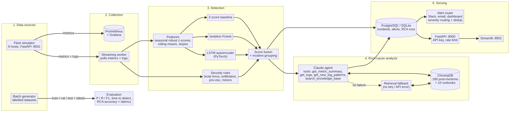

# AI Ops Copilot: Project Report

**ML anomaly detection, security detection and LLM root-cause analysis for a server fleet**

| | |
|---|---|
| Author | Ramesh Balaraju |
| Stack | Python 3.11, FastAPI, scikit-learn, PyTorch, ChromaDB, Claude (Anthropic API), SQLAlchemy + PostgreSQL, Streamlit, Prometheus, Grafana, Docker |
| Code | about 6,000 lines of application code, 1,100 lines of tests (86 tests), CI on GitHub Actions |

## 1. Problem

On-call engineers are flooded with alerts, most of which are noise, and when a real incident happens
they spend the first 20-30 minutes working out *what* broke and *why*. Static thresholds ("CPU > 90%")
fire on normal busy periods and miss slow problems such as memory leaks. Security events (SSH brute
force, data exfiltration, privilege escalation) often live in logs that nobody reads in real time.

**Goal:** a monitoring assistant that

1. collects server metrics and logs,
2. detects operational and security anomalies with machine learning, with few false alarms,
3. explains the likely root cause in plain English and suggests a fix, grounded in the team's past incidents,
4. alerts the right people on the right channel, and shows everything on a dashboard.

**Success criteria (measured):** precision, recall and F1 of detection; share of incidents caught and
how fast; false alarms per day; accuracy of the root-cause explanation; RCA response time.

## 2. System design

| Layer | Component | Implementation |
|---|---|---|
| Data | Fleet simulator + batch generator | 6 hosts, 10 metrics/minute, realistic logs, 10 incident types with 17 root causes, labels on every row, line and incident |
| Collection | Prometheus exporter + streaming worker | Simulator exposes `/metrics`; worker polls metrics and logs, 4-hour buffer per host |
| Features | Seasonal robust scaling | Per host, per hour-of-day median and IQR → robust z-scores; rolling means; memory/disk slopes |
| Detection | 4 detectors + fusion | Z-score, Isolation Forest (scikit-learn), LSTM autoencoder (PyTorch), security rule engine; normalised score fusion; incident grouping |
| Explanation | RAG + LLM agent | ChromaDB with 180 post-mortems + 10 runbooks; Claude agent with 4 tools and a JSON-schema answer; retrieval fallback |
| Serving | DB, alerts, API, UI | SQLAlchemy (PostgreSQL / SQLite), Slack/email/dashboard routing with dedup, FastAPI with API key + rate limiting, Streamlit |
| Operations | Docker + CI | docker-compose with 7 services and health checks; GitHub Actions: ruff, strict mypy, pytest, Docker build |

## 3. Data

Real incident data with ground truth is rare and sensitive, so the project generates it. The
simulator was designed to make detection *hard*, otherwise every model scores 100% and the numbers mean
nothing:

* **Normal behaviour** has daily and weekly cycles, autocorrelated noise (AR(1)), slow disk growth and random blips.
* **Hard negatives** look like incidents but are normal: nightly database backup (CPU, disk and network
  spike at 02:00), deploys, log rotation, a single mistyped SSH password, legitimate `sudo`.
* **Incidents differ in shape:** sudden steps (CPU spike), slow ramps (memory leak, disk fill), bursts
  (error burst), and near-invisible metric changes where the evidence is in the logs (privilege escalation).
* **Each incident type has 1-3 root causes** (for example an error burst is either an exhausted DB
  connection pool, an expired TLS certificate, or a bad deploy), each leaving its own clue in the logs.
  This lets us score whether the RCA picked the *right cause*, not just the right category.

**Evaluation protocol.** Three datasets with different random seeds and no overlap in time:

| Split | Length | Rows | Use |
|---|---|---|---|
| Train | 7 days | 60,480 | Fit scaler and models (labelled incident periods excluded) |
| Validation | 2 days | 17,280 | Choose thresholds (best F1) and fusion method |
| Test | 3 days | 25,920 (42 incidents) | Report results, touched once |
| History | 30 days | 259,200 (180 incidents) | Build the RAG knowledge base (post-mortems) |

## 4. Methods

### 4.1 Features

Each metric is converted to a robust z-score: `(value - median) / (IQR / 1.349)`, where the median
is computed per host and per hour of day and the IQR of the residuals per host (with a floor), all per host and per hour of day on normal training data. This
removes seasonality (busy noon vs quiet night) and is not pulled by the anomalies themselves. On top
come 5-minute rolling means of the z-scores (to catch sustained shifts) and 10-minute slopes of memory
and disk (to catch leaks and fills early).

### 4.2 Detectors

* **Z-score baseline:** the largest absolute z-score in the row. Simple and explainable; it is the bar
  the ML models have to beat.
* **Isolation Forest:** 300 trees on absolute feature values, trained only on normal rows. Unsupervised
  and fast; good at points that are unusual across many metrics at once.
* **LSTM autoencoder:** encoder-decoder LSTM (hidden 32, latent 8) trained to reconstruct 20-minute
  windows of normal data; the anomaly score is the reconstruction error of the last 3 minutes. It
  catches shapes, such as a slow ramp, that are not extreme at any single point.
* **Security rules:** streaming rules over logs. Brute force: ≥15 failed SSH logins from one IP in 5
  minutes (and a critical alert if that IP then logs in successfully); exfiltration: a single flow of
  ≥100 MB to an address outside the private networks; signatures for privilege escalation (sudoers
  edits, users added to the sudo group, SUID enumeration, unauthorised sudo) and suspicious processes
  (mining-pool connections, binaries run from /tmp, reverse shells), plus database dumps piped to an uploader.

### 4.3 Thresholds, fusion and grouping

Every detector's threshold is the value that maximises F1 on the validation split; scores are smoothed
with a 3-minute rolling mean per host. For fusion each score is divided by its own threshold (so 1.0
means "at threshold" for every model), and the fused score is the mean or the max of those, whichever
gives the better validation F1 (the mean won). A security rule hit raises an alarm regardless. Alarm
rows on one host within 5 minutes of each other form one incident, labelled with a suspected type from
the pattern of deviating metrics or the rule that fired.

### 4.4 Root-cause analysis

**Knowledge base.** Each of the 180 historical incidents is written up as a post-mortem: symptoms in
words ("memory usage far above normal; p95 latency far above normal"), the most frequent new log
templates (numbers and IP addresses masked), root cause and fix. With 10 runbooks this gives 190
documents, embedded with LSA (TF-IDF + truncated SVD, fully offline) and stored in ChromaDB.

**Claude agent.** For each incident the agent receives a short brief (host, window, deviating metrics,
rule hits) and can call four tools: `get_metric_summary`, `get_logs`, `get_new_log_patterns` and
`search_knowledge_base`. It decides what to look at, then returns a JSON object (summary, root cause,
root-cause id, fix, confidence, severity, evidence, similar incidents) that the API forces to follow a
JSON schema and that is validated again with Pydantic before storage. Logs are marked as untrusted
data in the system prompt, so text inside a log line cannot redirect the agent.

**Retrieval engine and fallback.** Without an API key the system uses a retrieval engine: it builds the
same kind of description for the new incident, retrieves the 15 most similar post-mortems, boosts those
of the suspected type, and lets the top 5 vote (weighted by similarity) on the root cause. The Claude
agent also falls back to this engine on any failure: network or API error, refusal, truncated output,
invalid JSON, or too many tool rounds.

### 4.5 Serving

The worker stores incidents and runs RCA and alerting in a thread pool so a slow LLM call never delays
detection. Alarms on the same host within 10 minutes extend the open incident rather than creating a
new one; if a security rule fires later the incident is re-labelled as that attack. Alerts are routed
by severity (critical/high: Slack + email + dashboard; medium: Slack + dashboard; low: dashboard) and
deduplicated with a unique constraint on (channel, host + type + cooldown window).

## 5. Results

### 5.1 Detection (test split, 42 incidents, 3 days)

| Detector | Precision | Recall | F1 | Incidents detected | Median time to detect | False alarms / day |
|---|---|---|---|---|---|---|
| Z-score baseline | 0.920 | 0.878 | **0.899** | 40/42 (95%) | 2.0 min | **3.7** |
| Isolation Forest | 0.770 | 0.727 | 0.748 | 42/42 (100%) | 2.5 min | 32.7 |
| LSTM autoencoder | 0.845 | 0.818 | 0.831 | 41/42 (98%) | 2.0 min | 12.7 |
| Security log rules | 1.000 | 0.165 | 0.283 | 17/42 (40%) | 0.0 min | 0.0 |
| **Hybrid** | 0.889 | **0.880** | 0.884 | **42/42 (100%)** | **1.0 min** | 5.7 |

Recall by incident type: the hybrid catches 100% of every type. The z-score baseline misses half of
the privilege-escalation incidents (their metric footprint is tiny), the LSTM misses one in four, the
rules catch all of them.

Training takes about 20 seconds on a laptop CPU; scoring costs about 0.1 ms per metric row, so one core
can monitor thousands of hosts at one-minute resolution. The suspected incident type assigned at
detection time is correct for 93% of detected incidents.

### 5.2 Root-cause analysis (incidents detected in the test split)

| Engine | Exact root cause | Incident type | Latency p50 | Latency p95 |
|---|---|---|---|---|
| Retrieval (offline) | 97.7% (42/43) | 97.7% | 0.21 s | 0.27 s |
| Claude agent | measured with `run_rca --engine llm` (needs an API key) | | several seconds (multiple tool calls) | |

"Exact root cause" means the specific cause out of 17 (for example *expired TLS certificate* rather than
just *error burst*). In the live demo, end-to-end RCA for a new incident took 50-90 ms with the
retrieval engine.

## 6. Discussion

**Did the deep learning model help?** On its own the LSTM is not better than the simple z-score
baseline (F1 0.83 vs 0.90), which is an honest and useful result: careful seasonal scaling does most of
the work. The LSTM's value is complementary: inside the hybrid it helps reach 100% incident recall and
halves the median time to detect, at the cost of about two extra false alarms per day.

**Why not only rules or only ML?** Rules have perfect precision but only cover attacks with log
signatures (40% of incidents). ML covers everything that moves metrics but cannot tell a brute-force
attack from a traffic spike. Fusing them gives coverage and explainability.

**Why use an LLM at all if retrieval scores 97.7%?** On simulated data, clue log lines map cleanly to
causes, which favours retrieval. Real incidents are messier: new failure modes, several simultaneous
symptoms, and logs that need reading rather than matching. The agent can investigate (look at a
different time window, read raw logs, compare runbooks) and write a human explanation. The retrieval
engine remains as the cheap, fast, always-available baseline and fallback.

**Errors.** The one RCA miss: the first alarm of a memory leak fired early, when the only new log line
in the window was a routine SSH login by the deploy user, so retrieval matched brute-force reports. The
next alarm on the same incident was explained correctly. The reported confidence was still 1.0, which
shows the vote share is not a calibrated probability. False alarms in the live demo were mostly the
nightly backup.

## 7. Security and engineering practices

* Secrets only in `.env` (git-ignored); `SecretStr` keeps them out of logs.
* API key checked in constant time; per-client token-bucket rate limiting; all inputs bounded and
  validated; CORS limited to the dashboard origin.
* Alert webhooks restricted to `https://hooks.slack.com/`; SMTP with STARTTLS.
* Ground-truth labels are removed before data reaches the detectors or the LLM.
* Containers run as non-root, ports bound to localhost, health checks on every service.
* 86 automated tests including an end-to-end worker test and a fake-client test of every LLM failure
  path; ruff and strict mypy in CI.

## 8. Limitations and future work

1. **Real data.** Add Prometheus and Loki adapters, then measure on a real fleet; expect retraining
   for concept drift.
2. **Calibrated confidence** for RCA (for example, Platt scaling on validation incidents).
3. **Maintenance windows** to silence known jobs such as backups.
4. **Feedback loop:** when an engineer resolves an incident with a different root cause, store it as a
   new post-mortem so the knowledge base learns.
5. **Scale-out:** Redis for rate limiting and a queue (Kafka / SQS) between detection and RCA.

## 9. Conclusion

AI Ops Copilot detects 100% of the injected incidents in unseen test data with a median time to detect
of one minute and about six false alarms per day across six hosts, and identifies the exact root cause
for 97.7% of them in under 0.3 seconds offline, with an LLM agent available for deeper investigation.
The project shows the full path from data to deployed service: realistic data with hard negatives, a
fair evaluation protocol, baselines before deep learning, an LLM that is grounded, validated and
optional, and production basics (auth, rate limits, alert dedup, tests, CI, Docker).
